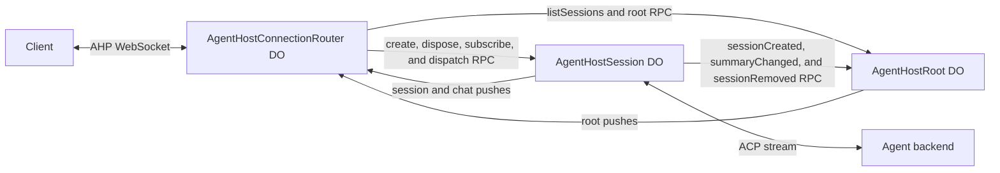

# Agent host

This package implements the [Agent Host Protocol](https://microsoft.github.io/agent-host-protocol/) on the Cloudflare dev platform using durable objects.

This allows you to build your factory using any combination of harnesses and handles all the nuances of multiple client connections + durability and delivery guarantees. You can set this up in only a handful of lines of code, view the examples directory for more information.

As long as your harness can speak ACP over websockets, it's supported. It doesn't matter if you are using a durable object based harness or one thats running in a container. Pseudo setup below

```typescript
export class AgentHostConnectionRouter extends BaseConnectionRouter<Env> {
  host = this.env.AGENT_HOST;
  session = this.env.AGENT_SESSION;
}

export class AgentHostRoot extends BaseAgentHostRoot<Env> {
  router = this.env.AGENT_ROUTER;

  getAgentInfo(): AgentInfo {
    return agentInfo;
  }
}

export class AgentHostSession extends BaseAgentHostSession<Env> {
  router = this.env.AGENT_ROUTER;
  host = this.env.AGENT_HOST;

  getAgentInfo(): AgentInfo {
    return agentInfo;
  }

  getWorkingDirectory(): string {
    return this.env.WORKSPACE_DIR;
  }

  async connectAgent(_sessionId: string): Promise<ACPStream> {
    await this.lifecycle.start();

    const { 0: client, 1: server } = new WebSocketPair();

    // here, you give your running agent the websocket connection so that
    // it can stream in incoming ACP events.
    connectAgentToAcp({ server });

    // this is a helper provided by @experiments/agent-host/helpers
    return websocketStream(client);
  }
}
```

# Slop low level overview

A minimal AHP 0.9 host built from three kinds of Durable Object.
Each session has one default chat and accepts one active text turn at a time.

- An `AgentHostConnectionRouter` owns one client WebSocket. The Worker creates a new router for
  each connection. The router answers `initialize`, `reconnect`, and `ping`, and counts the
  `serverSeq` of its connection.
- The `AgentHostRoot` owns the session catalogue and the root channel.
- An `AgentHostSession` owns one session: its ACP connection, its persisted conversation state,
  and the routers that subscribe to it.

The router sends `listSessions` and root subscriptions to the host. It sends
`createSession`, `disposeSession`, session and chat subscriptions, and `dispatchAction`
directly to the session. Sessions push their actions directly to the subscribed routers, so
streamed text does not pass through the host. Closing a client socket does not cancel a turn.

Each session keeps its own entry in the host catalogue. It calls `sessionCreated` before it
opens the agent connection, `summaryChanged` when a summary field other than `modifiedAt`
changes, and `sessionRemoved` before it deletes its storage. `createSession` and
`disposeSession` resolve after the host acknowledges the change, so `listSessions` is
correct when they resolve. The host never calls a session.



[ADR 0001](docs/adr/0001-connection-router.md) records why the host uses this shape.
[ADR 0002](docs/adr/0002-session-first-lifecycle.md) records why sessions own their creation
and disposal.

### Pushes

The host and each session send pushes to a router one at a time, in revision order. A push
carries the revision before it, so a router can find a missing revision. A router ignores
revisions that it already has. If a revision is missing, the router closes the WebSocket
with code 1011. The client then sends `reconnect` or `initialize` on a new connection. The
senders keep no history of actions.

Pushes are best effort. A sender stops pushing to a router that it cannot reach after its
retries. After a restart, a sender finds the routers that did not receive its latest
revision and tells them about the gap.

The contracts in `src/shared/rpc/router.ts`, `src/shared/rpc/host.ts`, and
`src/shared/rpc/session.ts` define typed requests, responses, and method-specific errors.
Errors from the host and the sessions keep an AHP error `code`, so the router sends the
same JSON-RPC error to the client. Check the `name`, `message`, and `code` of an RPC error.
Cloudflare does not preserve custom error prototypes. Runtime transport or object
initialization failures can also reject any RPC call.

## Extend the objects

Export concrete subclasses of all three classes from your Worker. The library does not
require any binding names.

- Override `getStub(kind, name)` in all three classes. It returns the stub of the host, a
  session, or a router with that Durable Object name. Build it from a `StubFactories`
  object so that TypeScript checks each kind:

  ```ts
  protected getStub<K extends StubKind>(kind: K, name: string): StubFor<K> {
    const stubs: StubFactories = {
      host: (id) => this.env.AGENT_HOST.getByName(id),
      session: (id) => this.env.AGENT_SESSION.getByName(id),
      router: (id) => this.env.AGENT_ROUTER.getByName(id),
    };

    return stubs[kind](name);
  }
  ```

- Override `AgentHostRoot.getAgentInfo()` and `AgentHostSession.getAgentInfo()` to describe the
  agent backends. The root can return one `AgentInfo` or an array. The session receives the
  requested provider during creation and the stored provider for later model checks. Return
  the matching metadata, or the default backend when no provider is given. The session checks
  the provider against the returned metadata and the model against its `models`. The ID of
  each model must be a value of the agent's ACP `model` config option. The agent connection
  fails if the option does not offer every listed model, so a creation fails at once.
- Override `AgentHostSession.connectAgent(sessionId, provider)` to return an ACP `Stream`. The stored
  provider selects the backend, including after a restart. Existing single-provider overrides
  can ignore the extra argument. See [the multi-agent example](examples/multi-agent) for Pi and
  OpenCode on the same host.
- Override `AgentHostSession.createAlarmScheduler(options)` when other code in the session
  object also needs the Durable Object alarm. The default scheduler keeps the named alarms in
  `durability` tables and owns the alarm. A replacement runs `options.handlers` with
  `options.policies`: each policy sets the attempt timeout, whether a timed-out attempt runs
  again, the number of attempts, and the delay between them. The
  `LifecycleSessionAlarms` from `@experiments/agent-host/helpers` runs the alarms as jobs of
  an `agents/lifecycle` Lifecycle. The [basic example](examples/basic) uses it with the
  Lifecycle that also wakes its Pi harness.
- Override `AgentHostSession.getWorkingDirectory()` when `/` is not the default.
- Override `AgentHostSession.getLifecyclePolicy()` to change the timing of the alarms that
  complete a creation or a dispose, and of the alarm that continues a turn.

All three classes require SQLite-backed Durable Object storage.
The migrations do not upgrade storage from earlier versions of this package. Delete local
`.wrangler` state after an upgrade. Import generated SQL
migrations as text in your Worker configuration. The [basic example](examples/basic)
provides concrete classes, bindings, and SQL import rules.

Use `routeAgentHost({ request, namespace })` in your Worker to route
`/hosts/<host-uuid>/ahp`. Pass the router namespace. Hosts and sessions use application
UUIDs. Session Durable Object names combine the host UUID and the session UUID. Router
Durable Object names combine the host UUID and a random UUID. Chat URIs have the form
`ahp-chat:/<session>/<chat>`, so a router finds the session of a chat from its URI. The
session assigns a chat UUID when it is created.

## Supported behavior

The host supports `initialize`, `reconnect`, `ping`, `listSessions`, `createSession`,
`disposeSession`, `subscribe`, and `unsubscribe`. Creation waits for ACP setup.

A repeated `createSession` with the same session ID, provider, and working directory waits
for the same creation, so a client can retry it. If a restart or a transient error stops a
creation, the request fails, and the session continues the creation in the background. A
client can retry, or watch the root channel for the result. An error response from the agent
fails the creation at once. A dispose that the host does not acknowledge fails, and the
session completes it in the background.
Clients dispatch `chat/turnStarted` and `chat/turnCancelled`. The session turns the ACP
updates of a prompt into response parts, in the order the agent sends them:

- `agent_message_chunk` text becomes markdown parts and `chat/delta`.
- `agent_thought_chunk` text becomes reasoning parts and `chat/reasoning`.
- `tool_call` and `tool_call_update` become tool call parts. A call that leaves `pending`
  runs without confirmation, its text content becomes `chat/toolCallContentChanged`, and
  `completed` or `failed` completes it with that content.
- The `usage` of the prompt response becomes `chat/usage`, with the full ACP usage under
  `_meta["agent-host/acpUsage"]`.

Text continues the last part if it has the same kind, and starts a new part otherwise. The
first part of a turn has the turn ID as its ID. The session handles the updates of a prompt one
at a time, in arrival order, and applies the completion or error action that ends the turn
after all of them.

A `chat/turnStarted` message can set `model` to the ID of one of the agent's models. Before
the prompt, the session selects it with ACP `session/set_config_option` on the agent's
config option with category `model`. The selection stays for later turns until a message
selects another model. A message with an unknown model, or with model `config`, is rejected.

Subscribe to root for the catalogue, a session for its default-chat reference,
and the chat for its conversation and activity status. The session summary in the
catalogue copies the status of the default chat. Sessions do not aggregate activity
across chats. Use the chat status.

State survives object reconstruction. The agent must support ACP `session/load` to continue
an existing conversation after its connection is lost. ACP load notifications do not
duplicate the retained AHP transcript.

A turn also survives a restart of the session or a lost agent connection, if the agent
supports the operation ID extension. The session sends the AHP turn ID as
`_meta["agent-host/operationId"]` of `session/prompt`. An agent that advertises
`agentCapabilities._meta["agent-host/operationId"]: true` runs each operation ID once. A
prompt with that ID starts with a replay of the output of the operation so far: its text,
thinking, and tool call updates, each with `_meta["agent-host/replay"]: { start, end }`.
`start` marks the first update and `end` the last. A new operation replays one empty
`agent_message_chunk`. A repeated prompt reattaches to the operation: after the replay come
the later updates and the result. `apps/harness-acp` implements the extension.

While a turn is active, the `continueTurn` alarm runs every `turnHeartbeatMs`. After a
restart, it opens a new agent connection and prompts again with the same operation ID. The
session matches the longest start of the replay to the stored parts in order, skipping stored
parts that the agent no longer has and parts of kinds that the output does not write. Matched
text parts get the text that the replay adds, and matched tool calls advance, so the turn keeps
one response. The rest of the replay, as after the agent generated text again, becomes new
parts. If all of the replay matches, its last part must match the last stored part, so later
text continues the right part. A second replay of the same output changes nothing. A lost connection schedules another attempt, and the turn ends
with an error after `turnAttempts` failures in a row or an error response from the agent.
A cancellation after a restart opens a connection to send `session/cancel`. Without the
extension, an unfinished turn becomes an error after a restart, because the session cannot
continue its prompt without running it again.

Sessions remain until explicit disposal. Disposal stops the connection and removes
AHP history. Backend-owned data follows the backend's own lifecycle.

To recover a client connection, send `reconnect` instead of `initialize` on a new connection.
The host keeps no replay log, so the result is always the `snapshot` variant. The result has a
new snapshot of each requested channel that still exists, and omits the other channels. Each
snapshot has `fromSeq` equal to `lastSeenServerSeq`, and the next action gets
`lastSeenServerSeq + 1`. Chat snapshots contain all retained turns, because `reconnect` has no
`view`. Clients replace their channel state and turn cursors, drop pending optimistic actions,
and fetch the catalogue again. The host does not send a prompt again or restart a turn. A failed
`reconnect` leaves the connection uninitialized, so the client can retry or initialize. A router
deletes its storage when its connection closes.

There are no multiple chats, tool approvals, resource APIs, terminals, authentication, or
automatic prompt retries. Tool call content other than text, plans, and model config values
are not shown.

## Database layout

Each Durable Object class owns its Drizzle database and migrations. Columns use unnamed builders,
typed JSON mode, and `casing: "snake_case"` in both runtime and Kit configuration.

```text
src/
├── router/
│   ├── durable-object.ts
│   ├── websockets.ts
│   ├── service/
│   │   ├── channels.ts
│   │   ├── gate.ts
│   │   ├── requests.ts
│   │   └── senders.ts
│   └── db/
├── host/
│   ├── durable-object.ts
│   ├── service/
│   │   ├── root.ts
│   │   └── sessions.ts
│   └── db/
├── session/
│   ├── durable-object.ts
│   ├── state.ts
│   ├── service/
│   │   ├── agent.ts
│   │   ├── session.ts
│   │   └── store.ts
│   └── db/
├── shared/
│   ├── db/
│   │   └── fanout-schema.ts
│   ├── do-rpc.ts
│   ├── errors.ts
│   ├── fanout.ts
│   ├── lookups.ts
│   ├── names.ts
│   ├── protocol.ts
│   ├── push-queue.ts
│   ├── stubs.ts
│   └── rpc/
│       ├── errors.ts
│       ├── host.ts
│       ├── router.ts
│       └── session.ts
├── helpers/
│   ├── README.md
│   ├── index.ts
│   ├── router.ts
│   └── websocket-stream.ts
└── index.ts
```

The router database has the `serverSeq` of the connection in the `connection` row, the
client subscriptions with their snapshot revisions in `subscriptions`, and the last revision
received from each sender in `senders`. A sender is the host or one session. The router
deletes its storage when the connection closes.

The host database has the `sessions` catalogue, the root revision, and the routers that
subscribe to the root channel. The host writes each catalogue change and the new root
revision in one transaction.

The session database has one `session` row with typed session state and chat state, and
the routers that subscribe to the session. A session object creates its tables only when
the session is created, and deletes all storage when the session is disposed. The
`session` row holds the entire transcript, and the session rewrites the row for each
action. SQLite limits rows to 2 MB, so this version is for small conversations.
Transcript normalization and streaming batching are future work.

The host and the sessions use the same `RouterFanout` (`src/shared/fanout.ts`) to push
updates. It stores the subscribed routers and their channels in the `subscriber_routers`
and `subscriber_channels` tables of the sender, with the last revision that each router
received.

Each sender sends one root change or one batch of session revisions at a time to each
router. A slow router does not delay other routers. The host still sends each root change
to every router that subscribes to the root channel. This cost grows with the number of
connected clients.

This implementation uses fresh schemas. It does not migrate the previous host
implementation's data or preserve its APIs.

## Development

From the repository root:

```sh
pnpm --filter @experiments/agent-host db:generate
pnpm --filter @experiments/agent-host check-types
pnpm --filter @experiments/agent-host test
pnpm run lint
pnpm run format
```

The Workers tests use custom binding names and an in-process ACP agent. They test
shared streaming, independent concurrent sessions, cancellation, reconstruction,
client disconnection, disposal, push ordering, gaps after a restart, and catalogue sync.

The same `test` command also runs `test/integration` through Wrangler's
`createTestHarness()`. The integration fixture reuses the basic example's concrete Worker
and Durable Objects with the real Pi harness, ACP WebSocket adapters, and workspace tools.
Only the model provider uses Faux. Tests cover shared streaming, a workspace write,
thinking and tool call parts, model selection, history recovery after a session restart, a
turn that continues across a restart, and disposal. The harness resets storage between
tests and prints runtime diagnostics on failure. No Cloudflare credentials are required.

Run `pnpm --filter @experiments/agent-host test:workers` or
`pnpm --filter @experiments/agent-host test:integration` to run either suite alone.
