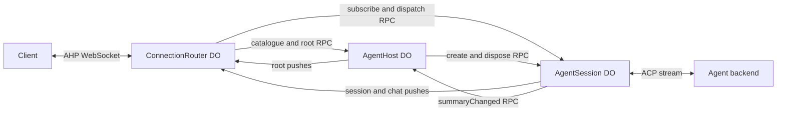

# Agent host

A minimal AHP 0.9 host built from three kinds of Durable Object.
Each session has one default chat and accepts one active text turn at a time.

- A `ConnectionRouter` owns one client WebSocket. The Worker creates a new router for each
  connection. The router answers `initialize` and `ping`, and counts the `serverSeq` of
  its connection.
- The `AgentHost` owns the session catalogue and the root channel.
- An `AgentSession` owns one session: its ACP connection, its persisted conversation state,
  and the routers that subscribe to it.

The router sends `listSessions`, `createSession`, `disposeSession`, and root subscriptions
to the host. It sends session and chat subscriptions and `dispatchAction` directly to the
session. Sessions push their actions directly to the subscribed routers, so streamed text
does not pass through the host. A session tells the host only when a summary field other
than `modifiedAt` changes. Closing a client socket does not cancel a turn.



[ADR 0001](docs/adr/0001-connection-router.md) records why the host uses this shape.

### Pushes

The host and each session send pushes to a router one at a time, in revision order. A push
carries the revision before it, so a router can find a missing revision. A router ignores
revisions that it already has. If a revision is missing, the router closes the WebSocket
with code 1011, and the client initializes again. The senders keep no history of actions.

Pushes are best effort. A sender stops pushing to a router that it cannot reach after its
retries. After a restart, a sender finds the routers that did not receive its latest
revision and tells them about the gap.

The contracts in `src/shared/rpc/router.ts`, `src/shared/rpc/host.ts`, and
`src/shared/rpc/session.ts` define typed requests, responses, and method-specific errors.
Errors from the host and the sessions keep an AHP error `code`, so the router sends the
same JSON-RPC error to the client. Check the `name`, `message`, and `code` of an RPC error.
Cloudflare does not preserve custom error prototypes. Runtime transport or object
initialization failures can also reject any RPC call.

## Extend the objects

Export concrete subclasses of all three classes from your Worker. The library does not
require any binding names.

- Override `getStub(kind, name)` in all three classes. It returns the stub of the host, a
  session, or a router with that Durable Object name. Build it from a `StubFactories`
  object so that TypeScript checks each kind:

  ```ts
  protected getStub<K extends StubKind>(kind: K, name: string): StubFor<K> {
    const stubs: StubFactories = {
      host: (id) => this.env.AGENT_HOST.getByName(id),
      session: (id) => this.env.AGENT_SESSION.getByName(id),
      router: (id) => this.env.AGENT_ROUTER.getByName(id),
    };

    return stubs[kind](name);
  }
  ```

- Override `AgentHost.getAgentInfo()` to describe the single agent backend.
- Override `AgentSession.connectAgent(sessionId)` to return an ACP `Stream`.
- Override `AgentSession.getWorkingDirectory()` when `/` is not the default.

All three classes require SQLite-backed Durable Object storage. Import generated SQL
migrations as text in your Worker configuration. The [basic example](examples/basic)
provides concrete classes, bindings, and SQL import rules.

Use `routeAgentHost({ request, namespace })` in your Worker to route
`/hosts/<host-uuid>/ahp`. Pass the router namespace. Hosts and sessions use application
UUIDs. Session Durable Object names combine the host UUID and the session UUID. Router
Durable Object names combine the host UUID and a random UUID. Chat URIs have the form
`ahp-chat:/<session>/<chat>`, so a router finds the session of a chat from its URI. The host
assigns a chat UUID when it creates a session.

## Supported behavior

The host supports `initialize`, `ping`, `listSessions`, `createSession`,
`disposeSession`, `subscribe`, and `unsubscribe`. Creation waits for ACP setup.
Clients dispatch `chat/turnStarted` and `chat/turnCancelled`. Agent text becomes
markdown response parts and deltas, followed by completion or error actions.

Subscribe to root for the catalogue, a session for its default-chat reference,
and the chat for its conversation and activity status. The session summary in the
catalogue copies the status of the default chat. Sessions do not aggregate activity
across chats. Use the chat status.

State survives object reconstruction. An unfinished turn becomes a non-resumable
error after reconstruction. The agent must support ACP `session/load` to continue
an existing conversation after its connection is lost. ACP load notifications do
not duplicate the retained AHP transcript.

Sessions remain until explicit disposal. Disposal stops the connection and removes
AHP history. Backend-owned data follows the backend's own lifecycle.

To recover a client connection, initialize a new connection, fetch the catalogue,
and subscribe again. There is no `reconnect` handler or replay log. Each connection has
its own `serverSeq`, and a router deletes its storage when its connection closes. There are no
multiple chats, tool approval UI, resource APIs, terminals, authentication, or
automatic prompt retries. Agent tools may still run internally.

## Database layout

Each Durable Object class owns its Drizzle database and migrations. Columns use unnamed builders,
typed JSON mode, and `casing: "snake_case"` in both runtime and Kit configuration.

```text
src/
├── router/
│   ├── durable-object.ts
│   ├── websockets.ts
│   ├── service/
│   │   ├── channels.ts
│   │   ├── gate.ts
│   │   ├── requests.ts
│   │   └── senders.ts
│   └── db/
├── host/
│   ├── durable-object.ts
│   ├── service/
│   │   ├── root.ts
│   │   └── sessions.ts
│   └── db/
├── session/
│   ├── durable-object.ts
│   ├── state.ts
│   ├── service/
│   │   ├── agent.ts
│   │   ├── session.ts
│   │   └── store.ts
│   └── db/
├── shared/
│   ├── db/
│   │   └── fanout-schema.ts
│   ├── do-rpc.ts
│   ├── errors.ts
│   ├── fanout.ts
│   ├── lookups.ts
│   ├── names.ts
│   ├── protocol.ts
│   ├── push-queue.ts
│   ├── stubs.ts
│   └── rpc/
│       ├── errors.ts
│       ├── host.ts
│       ├── router.ts
│       └── session.ts
├── helpers/
│   ├── README.md
│   ├── index.ts
│   ├── router.ts
│   └── websocket-stream.ts
└── index.ts
```

The router database has the `serverSeq` of the connection in the `connection` row, the
client subscriptions with their snapshot revisions in `subscriptions`, and the last revision
received from each sender in `senders`. A sender is the host or one session. The router
deletes its storage when the connection closes.

The host database has the `sessions` catalogue, the root revision, and the routers that
subscribe to the root channel. The host writes each catalogue change and the new root
revision in one transaction.

The session database has one `session` row with typed session state and chat state, and
the routers that subscribe to the session. A session object creates its tables only when
the session is created, and deletes all storage when the session is disposed. The
`session` row holds the entire transcript, and the session rewrites the row for each
action. SQLite limits rows to 2 MB, so this version is for small conversations.
Transcript normalization and streaming batching are future work.

The host and the sessions use the same `RouterFanout` (`src/shared/fanout.ts`) to push
updates. It stores the subscribed routers and their channels in the `subscriber_routers`
and `subscriber_channels` tables of the sender, with the last revision that each router
received.

Each sender sends one root change or one batch of session revisions at a time to each
router. A slow router does not delay other routers. The host still sends each root change
to every router that subscribes to the root channel. This cost grows with the number of
connected clients.

This implementation uses fresh schemas. It does not migrate the previous host
implementation's data or preserve its APIs.

## Development

From the repository root:

```sh
pnpm --filter @experiments/agent-host db:generate
pnpm --filter @experiments/agent-host check-types
pnpm --filter @experiments/agent-host test
pnpm run lint
pnpm run format
```

The Workers tests use custom binding names and an in-process ACP agent. They test
shared streaming, independent concurrent sessions, cancellation, reconstruction,
client disconnection, disposal, push ordering, gaps after a restart, and catalogue sync.
