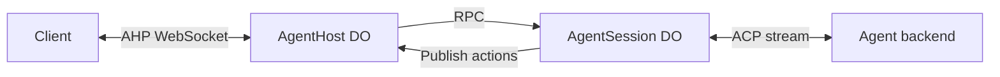

# Agent host

A minimal AHP 0.9 host with one Durable Object per host and one per session.
Each session has one default chat and accepts one active text turn at a time.

The host owns client WebSockets, the session catalogue, subscriptions, and
`serverSeq`. Session objects own ACP connections and persisted conversation
state. Sessions publish actions to their host over RPC. Closing a client socket
does not cancel a turn.



## Extend the objects

Export concrete subclasses from your Worker. The library does not require any
binding names.

- Override `AgentHost.getAgentInfo()` to describe the single agent backend.
- Override `AgentHost.getSessionNamespace()` to return your session binding.
- Override `AgentSession.getHostNamespace()` to return your host binding.
- Override `AgentSession.connectAgent(sessionId)` to return an ACP `Stream`.
- Override `AgentSession.getWorkingDirectory()` when `/` is not the default.

Both classes require SQLite-backed Durable Object storage. Import generated SQL
migrations as text in your Worker configuration. The [basic example](examples/basic)
provides concrete classes, bindings, and SQL import rules.

Use `routeAgentHost({ request, namespace })` in your Worker to route
`/hosts/<host-uuid>/ahp`. Hosts and sessions use application UUIDs; session DO names
combine the host UUID and session UUID. Protocol URIs are constructed at the wire
boundary. Chat UUIDs are assigned when sessions are created.

## Supported behavior

The host supports `initialize`, `ping`, `listSessions`, `createSession`,
`disposeSession`, `subscribe`, and `unsubscribe`. Creation waits for ACP setup.
Clients dispatch `chat/turnStarted` and `chat/turnCancelled`. Agent text becomes
markdown response parts and deltas, followed by completion or error actions.

Subscribe to root for the catalogue, a session for its default-chat reference,
and the chat for its conversation and activity status. The host updates catalogue
status and the session's chat summary. Session-level activity aggregation is not
implemented; use the chat status.

State survives object reconstruction. An unfinished turn becomes a non-resumable
error after reconstruction. The agent must support ACP `session/load` to continue
an existing conversation after its connection is lost. ACP load notifications do
not duplicate the retained AHP transcript.

Sessions remain until explicit disposal. Disposal stops the connection and removes
AHP history. Backend-owned data follows the backend's own lifecycle.

To recover a client connection, initialize a new connection, fetch the catalogue,
and subscribe again. There is no `reconnect` handler or replay log. There are no
multiple chats, tool approval UI, resource APIs, terminals, authentication, or
automatic prompt retries. Agent tools may still run internally.

## Database layout

Each DO owns its Drizzle database and migrations. Columns use unnamed builders,
typed JSON mode, and `casing: "snake_case"` in both runtime and Kit configuration.

```text
src/
├── host/
│   ├── router.ts
│   ├── durable-object.ts
│   ├── requests.ts
│   ├── connections.ts
│   └── db/
│       ├── schema.ts
│       ├── database.ts
│       ├── drizzle.config.ts
│       ├── migrations/
│       └── repositories/
│           ├── host.ts
│           └── sessions.ts
├── session/
│   ├── durable-object.ts
│   ├── state.ts
│   └── db/
│       ├── schema.ts
│       ├── database.ts
│       ├── drizzle.config.ts
│       ├── migrations/
│       └── repositories/
│           └── session.ts
├── agent/
│   ├── connection.ts
│   └── updates.ts
├── helpers/
├── index.ts
├── protocol.ts
└── types.ts
```

The host database has `host` and `sessions` tables. The session database has one
`session` row with typed session state, chat state, and summary JSON. This stores
the entire transcript in one row and rewrites it for each action. SQLite limits
rows to 2 MB, so this version is intended for small conversations. Transcript
normalization and streaming batching are future work.

The host remains the shared publication point. Hundreds of session objects
distribute agent execution, but they do not remove the host's throughput limit.

This implementation uses fresh schemas. It does not migrate the previous host
implementation's data or preserve its APIs.

## Development

From the repository root:

```sh
pnpm --filter @experiments/agent-host db:generate
pnpm --filter @experiments/agent-host check-types
pnpm --filter @experiments/agent-host test
pnpm run lint
pnpm run format
```

The Workers tests use custom binding names and an in-process ACP agent. They test
shared streaming, independent concurrent sessions, cancellation, reconstruction,
client disconnection, and disposal.
